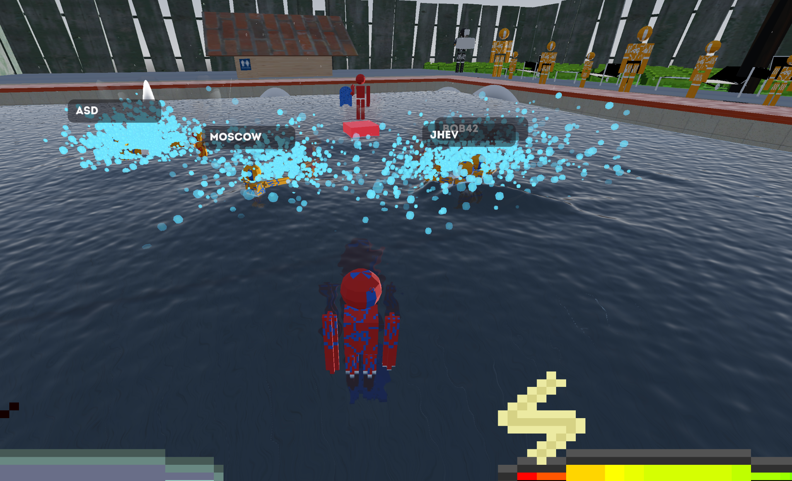

# Flowstate

After going to the pool, have you ever wanted to do your crazy water fights online?
Well now you can! Introducing Flowstate! (I hastily made this name up)

Download here: [goto](https://github.com/OrtheSnowJames/orthesnowjames.github.io/releases/tag/flowstate-latest)

An example of King of the Cube:

## Movement

Getting around the pool isn't just holding W. 

1. Walking - On dry land or in the shallow end, forward/back gets you moving up to a capped walking speed. Let go and it fades right back out.
2. Swimming - Hold the swim key and forward/back to actually get going. There's a short wind-up before you hit full speed, and backstrokes wind up faster than forward strokes.
3. Gliding - Let go of the swim key without stopping and you'll coast on your last heading, bleeding momentum the whole way, until you run dry or hit a movement key.
4. Turning - A/D turn you (and the camera with you) instead of strafing. There's an option to make holding a turn key ramp up instead of turning at full speed right away.
5. Backstroke flip - Tap forward right after letting go of back and you'll spin 180° on the spot without losing momentum, instead of coasting to a stop first.
6. Dodge - Double-tap A or D to dodge sideways. Only works in the shallow end or on dry land, since there's nothing to push off of in open water. Costs stamina and has its own cooldown.
7. Jump - Same shallow-end-or-dry-land rule as the dodge. A jump spends your ENTIRE momentum bar on the way up - the more you had, the higher you go, but you land with none of it left.
8. Scoreboard - Press F to pan the camera to the scoreboard. The scoreboard measures how many times your team has drowned an enemy. First to the goal wins!

## Combat

There are a few combat features we made. First, there are 2 roles.
1. Normal - Just a normal dude.
2. Lifeguard - Chosen randomly. Expends less stamina, goes faster, and can revive drowned teammates.

Next, we need to cover stamina. You can't just swim forever!
You only have 100 points of stamina.
1. When you get hit, you lose a TON of stamina.
2. When you use an attack, you lose a little bit of stamina.
3. When you swim or tread, you lose stamina.
4. Standing in the shallow end is the only way to recover stamina.

If you lose all your stamina, you drown/faint. Here's what that actually means.
1. You go limp and just drift with the water - no more input until someone brings you back.
2. Your screen fades to black and your ears start ringing. It's unsettling on purpose.
3. Any lifeguard on your team can swim up next to you and revive you, handing back half your stamina and snapping your screen right back open.
4. If the lifeguard drowns, the whole team can't revive anymore - not even to save the lifeguard themself.
5. If your whole team drowns, the round's over and the other team wins. Everyone gets revived automatically so nobody's left staring at black, then it's back to the lobby for a rematch.

Don't worry! That's why we made the lifeguard an absolute unit.
1. The lifeguard can block most of an attack's damage, since it's holding a kickboard.
2. The lifeguard can hit for 80 points of stamina damage if performed correctly.
3. The lifeguard expends virtually no stamina swimming or treading.

Now let's talk Momentum. It decides how hard your attacks hit and how high you can jump.
1. The more momentum you have, the higher you can jump.
2. You build momentum by swimming, and backstrokes build it 2x as fast as swimming forward.
3. Attack while swimming and you'll dump your entire momentum bar into the hit. This can more than double your attack power.

What you've all been waiting for, finally, the moves.
Press the key with the number to fire it.
1. Water Power - Launches a long range wave that hits harder the farther away the enemy is.
2. Water Attack - Shoots a burst of short range water that hits harder the closer the enemy is.
3. Water Wall - Halves incoming damage while it's up.
4. Water Counter - Water Walls and Water Powers, but takes 50 stamina.
5. Water Pelt - Shoots some bubbles of water that do little damage unless the opponent is on a cube.

# King of the Cube

King of the cube is a mode where you secure victory by standing on the cube for a minute and a half.

When you stand on the cube, you gain 1 point per second. The first team to 120 points wins.

Tactics:
- Get a lifeguard on the cube
- Surround the lifeguard with expendable players below the cube surrounding it
- Put the cube in a corner so it's easier to defend
- Move the cube to your half so the other team respawns further away from the cube
- Have the lifeguard firing water pelts and the players firing water attacks/powers or even run walls

## Arcade Mode

Arcade mode is a more arcadey mode. The controls are weirder and the physics isn't realistic.
You have 200 max stamina, and the mechanic is jumping.

The main controls are Q and E.

Jump up and dash at your opponent with Q.

If you dash at each other, you get into a fist fight where you both have to press Q and E.

If you fail to press them repeatedly in the same order fast enough, you fall and are vulnerable.
Otherwise, you can either mantle up to gain more height or dash back to where you were (Q to dash back.)

## Death and Spectating

When your stamina reaches zero, you unfortunately drown. Don't worry!
You can still look at your team! There's a gray guy on the sidelines who flies a drone.
This drone allows you to spectate the lifeguard while you're drowned, until the lifeguard revives you.
If the lifeguard dies, you can only see an overhead view of the pool. All hope is lost.

If a game just started, you can still spectate! When you join, press the spectate button.

## VR Controls (very weird at first)

In a real pool, you swim very realistically. In VR, you flap your hands and go zoom.

To swim, put your hands in the water and imitate a very bad swimming stroke.
It doesn't really matter how bad, as long as the hands touch the water.

To attack, put one hand in the water and swing it forward. The harder, the stronger the attack.

Normal Controls (sorta):
- To jump, press A (as usual.)
- To dodge, use the grip buttons.
- To water pelt, press either of the triggers.
- To water wall, hold both triggers and flail your hands back and forth.
- Water counter got removed for balancing purposes.
- Jump Cancelling got removed also for balancing purposes. Now you can swim really fast in VR.

Hold both joysticks to exit a game.
What I think is really cool is people can see your hand positions. Yeah.

In arcade mode, Left and Right trigger replace Q and E.

## Controller settings

Similar to VR controls, but with more options.

In controller mode, press the +/Options button to exit.

- Cross/Bottom button to Jump
- Circle/Right button to Water Power
- Square/Left button to Water Attack
- Triangle/Top button to Water Wall
- In solo play, press L on keyboard or D-pad down to toggle lifeguard.
- D-pad right to revive
- D-pad up to look at the scoreboard (F on keyboard)
- D-pad left in solo play to change mode (Normal, KOTC, Arcade)
- D-pad left or right to dodge also.
- L2/R2 for arcade Q or E
- Click the stick in to swim
- R2/RT to Water Pelt

## Matchmaking

### Quick Play/Join Code

To hop in a match and play fast, press the quick play button, connecting you to an open room or making a new one. Make sure you have internet at all times! (You will need to communicate to the matchmaker)
If you want to join a friend without their IP, you can join with a code if they used quick play.

### Custom Servers

If you don't want to connect to matchmaking and have randoms join your room, you can make your own server.
You just share the IP and port with your friends and they can connect.

### Solo Play

If you just want to play alone, there's always solo play. It doesn't require internet.

#### Fake Friends

Not the real name for the feature, but good enough.

This feature lets you place fake players in the water to practice with.

Step by step:
- Ctrl+C to spawn a player at your location
- Ctrl+E while hovering over a player to edit its settings
- You can edit the move the player spams, infinite stamina, lifeguard and team
- Ctrl+D while hovering over a player to delete it

## VR Builds

Forgive me. I used powershell. I know. But I had to because of windows.

### How to Build
On Windows, `.\start_vr.ps1` starts PCVR without generating Quest texture formats.
Use `pwsh -File ./build_quest.ps1` on Windows (just use `.\build_quest.ps1`), macOS or Linux to export a standalone Quest debug APK at `build/flowstate-quest.apk`.
Both scripts accept `-Godot "C:\path\to\Godot.exe"`; the build script also accepts `-Output` and/or `-Release`.

### Prerequisites
- Godot 4.6+ export templates
- Android SDK, JDK 17 and debug keystore configured in Godot
- Internet access for Gradle dependencies (first build only)

### Other Notes
AS (ante-script): This setup takes a while as android is pretty annoying. I could probably just make a [release](https://github.com/OrtheSnowJames/orthesnowjames.github.io/releases/tag/flowstate-latest) of the .apk...
Release exports additionally need release signing configured in the Meta Quest export preset.
Quest imports live in `.godot/quest-build/project`, separate from the PCVR cache; the first Quest export imports assets once.

## TODO:
- Done: Diving board
- Done: Voice chat
- Done: Solo Play Sandbox
- "Fun" mode - water balloons, higher ground, otter pops and more fun I guess (I realize I made this game too competitive)
- Done? Untested, also only in alpha on my meta dashboard: VR couch parties with quest friends
- Done: Fix bug where you can clip out of map
- Done: Make stamina only start running out when you start moving
